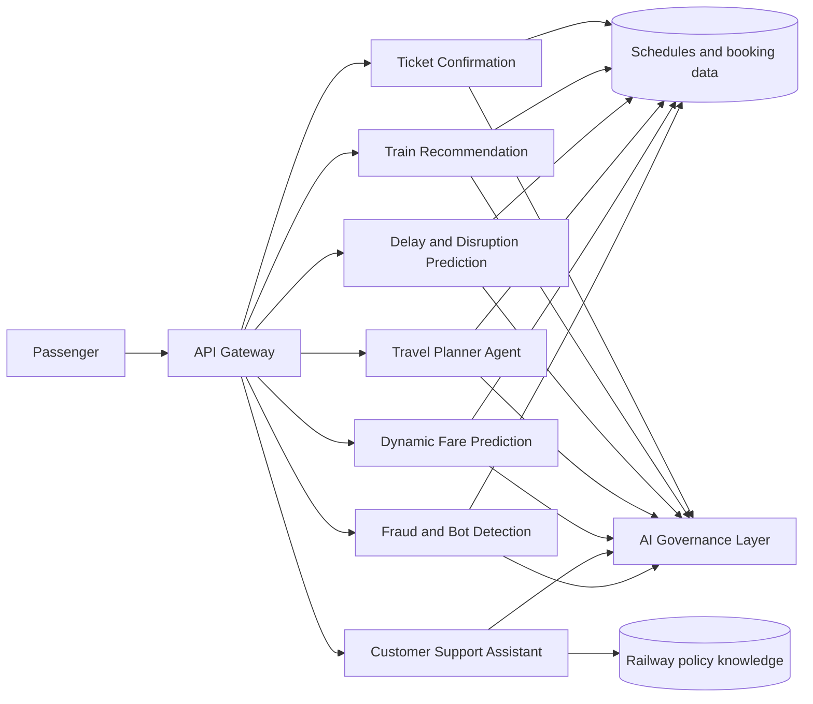
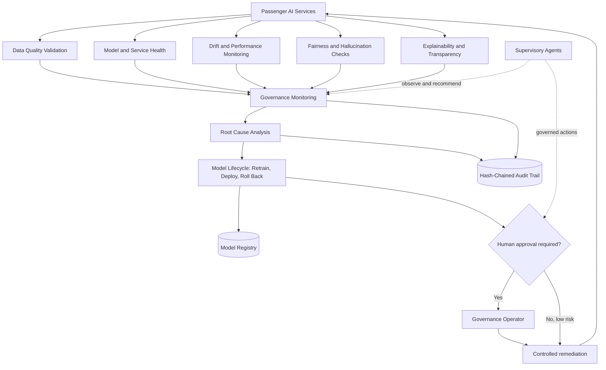
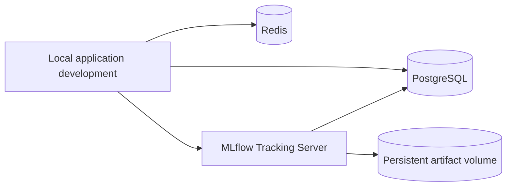

# Architecture

## Target platform

The diagrams describe the intended platform boundaries from the problem statement. Phases 0 and 1 deliver the repository tooling, local PostgreSQL/Redis/MLflow dependencies, shared Python libraries, initial data models, and synthetic data loaders. Passenger-facing and governance services below are not implemented yet.

## Governance layer

Every model-backed service is expected to publish predictions, confidence, explanations, model version, and health/metrics information to the governance layer. Governance decisions and service events must be auditable. High-risk actions require human approval; travel booking always requires explicit passenger approval.

## Phase 0 local dependencies

PostgreSQL, Redis, and MLflow are exposed on localhost for development. The Compose stack uses named volumes for database, Redis, and MLflow artifact persistence. MLflow is unauthenticated and must not be exposed to an untrusted network.
